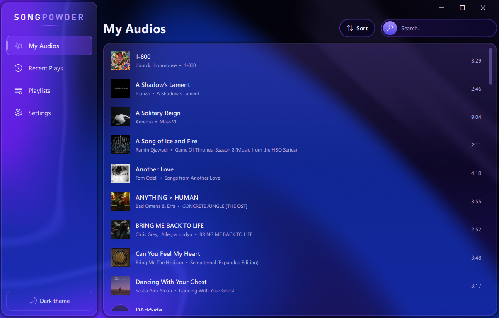
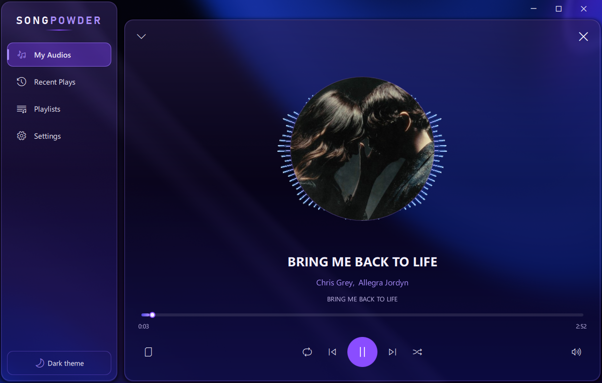
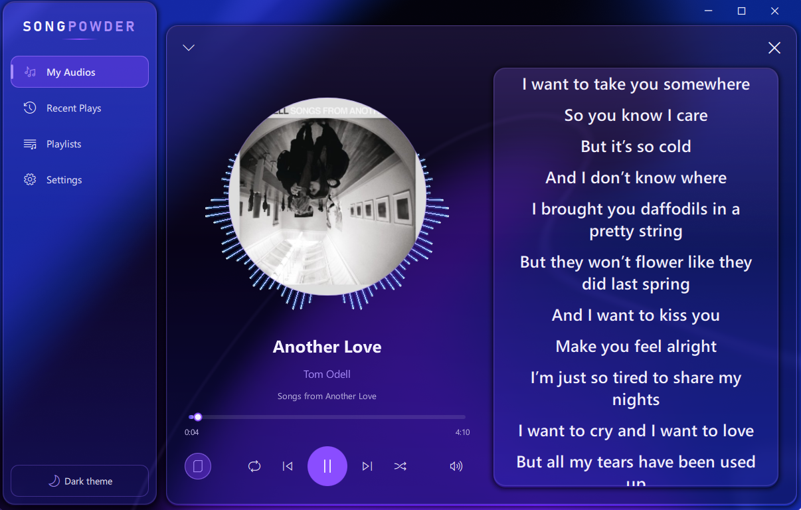
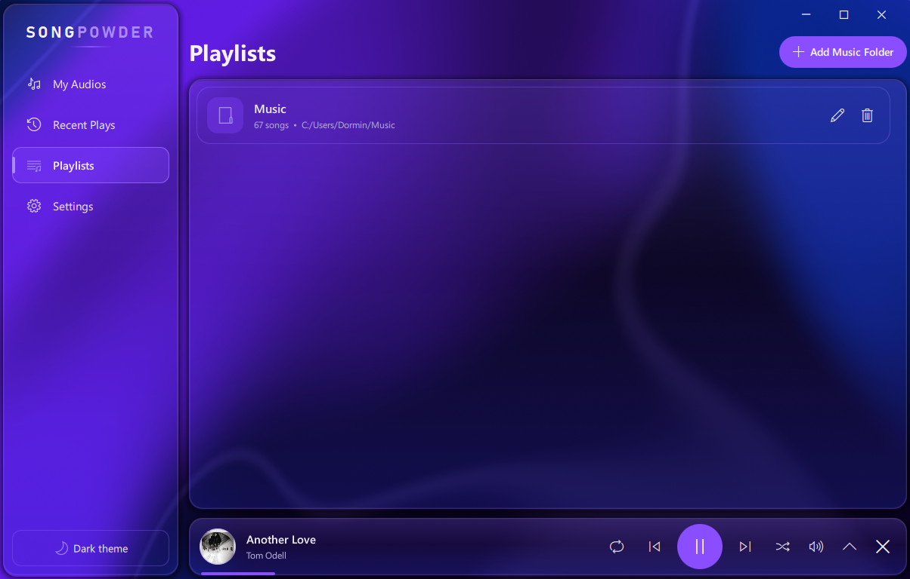
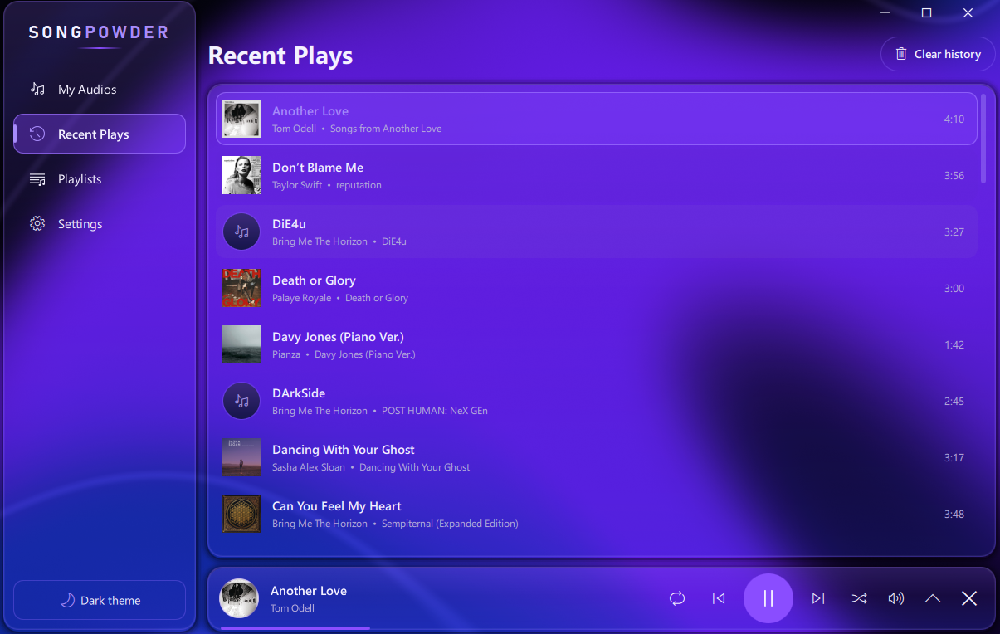
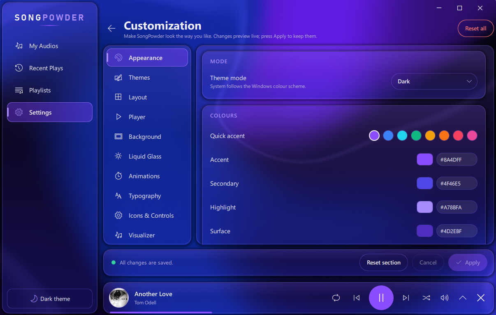

<div align="right" dir="rtl">

[🇮🇷 فارسی](README.fa.md)

</div>

<div align="center">


# SongPowder

**یک پخش‌کننده موسیقی سریع و مدرن برای ویندوز با ظاهر Liquid Glass.**

ساخته‌شده با C++20، Qt 6 و QML.


</div>

---

SongPowder موسیقی‌هایی را پخش می‌کند که از قبل در اختیار دارید. کافی است پوشه‌های موسیقی خود را به آن معرفی کنید؛ باقی کارها را خودش انجام می‌دهد: پوشه‌ها را در پس‌زمینه اسکن می‌کند، تگ‌ها و تصاویر جلد آلبوم را می‌خواند، تغییرات را زیر نظر می‌گیرد و هرگز فایل‌های شما را جابه‌جا، کپی یا حذف نمی‌کند. تم‌های روشن و تاریک، متن آهنگ همگام‌سازی‌شده، اکولایزر زنده در اطراف تصویر جلد و صفحه‌ای با امکانات گسترده شخصی‌سازی، تجربه‌ای متناسب با سلیقه شما فراهم می‌کنند.

## قابلیت‌ها

- **پوشه‌ها به‌عنوان پلی‌لیست.** هر تعداد پوشه موسیقی که می‌خواهید اضافه کنید. هر پوشه به یک پلی‌لیست تبدیل می‌شود و تغییرات آن به‌صورت خودکار زیر نظر گرفته می‌شود.
- **اسکن در پس‌زمینه.** تگ‌ها و تصاویر جلد بدون متوقف کردن رابط کاربری خوانده می‌شوند. فایل‌هایی که امکان رمزگشایی آن‌ها وجود ندارد شناسایی و مخفی می‌شوند.
- **پخش کامل موسیقی.** پخش، توقف، جابه‌جایی در آهنگ، آهنگ بعدی و قبلی، تکرار و پخش تصادفی؛ در حالت پخش تصادفی، تا زمانی که تمام چرخه پخش نشده باشد هیچ آهنگی دوباره تکرار نمی‌شود.
- **متن آهنگ همگام‌سازی‌شده.** فایل‌های `.lrc`، `txt` (از جمله متن همگام‌شده کلمه‌به‌کلمه)، SRT و WebVTT و همچنین فایل‌های متنی ساده را می‌خواند. از زبان‌های فارسی و عربی به‌طور کامل، از جمله چیدمان راست‌به‌چپ، پشتیبانی می‌شود.
- **اکولایزر زنده.** طیف‌نمایی شعاعی در اطراف تصویر جلد آلبوم که به‌صورت لحظه‌ای با موسیقی هماهنگ می‌شود.
- **شخصی‌سازی.** رنگ‌ها، فونت‌ها، افکت شیشه‌ای، حرکت‌ها، چیدمان و سبک پلیر؛ همراه با تم‌ها و پروفایل‌هایی که می‌توانید ذخیره، وارد و صادر کنید.
- **آهنگ‌های اخیر.** تاریخچه شنیدن موسیقی شما به‌صورت محلی در SQLite ذخیره می‌شود.
- **پشتیبانی از فرمت‌های متنوع.** MP3، FLAC، WAV، AAC، M4A، OGG، OPUS، WMA و AIFF (فهرست دقیق فرمت‌ها به بک‌اند Qt FFmpeg بستگی دارد).

## تصاویر برنامه

<table>
  <tr>
    <td align="center"><br /><sub>موسیقی‌های من</sub></td>
    <td align="center"><br /><sub>در حال پخش</sub></td>
  </tr>
  <tr>
    <td align="center"><br /><sub>متن آهنگ همگام‌سازی‌شده</sub></td>
    <td align="center"><br /><sub>پلی‌لیست‌ها</sub></td>
  </tr>
  <tr>
    <td align="center"><br /><sub>پخش‌های اخیر</sub></td>
    <td align="center"><br /><sub>شخصی‌سازی</sub></td>
  </tr>
</table>

## استفاده از کد منبع

برای کار با این پروژه سه روش وجود دارد. تمام دستورها با این فرض نوشته شده‌اند که در پوشه اصلی پروژه قرار دارید.

### ۱. ساخت نسخه قابل‌حمل و فایل نصب در یک مرحله

PowerShell را باز کنید و دستور زیر را اجرا کنید:

```powershell
.\scripts\package.bat -QtDir "C:\Qt installation path\Folder Version\msvc2022_64" -InnoDir "Inno Setup6 installation path"
```

اگر گزینه `-QtDir` را وارد نکنید، اسکریپت تلاش می‌کند محل نصب Qt را به‌صورت خودکار پیدا کند. پس از پایان اجرا، خروجی‌ها را در پوشه `dist` خواهید یافت:

```text
dist\SongPowder\                      پوشه نسخه قابل‌حمل؛ فایل SongPowder.exe را اجرا کنید
dist\SongPowder-Portable-<version>.zip
dist\SongPowder-Setup-<version>.exe   فایل نصب
```

گزینه‌های کاربردی: `-RunTests`، `-SmokeTest`، `-SkipInstaller`، `-SkipPortableZip` و `-Clean`.

### ۲. باز کردن پروژه در Qt Creator

1. فایل `CMakeLists.txt` را در Qt Creator باز کنید.
2. کیت **Desktop Qt 6.x MSVC2022 64-bit** را انتخاب کنید.
3. روی **Run** کلیک کنید.

### ۳. ساخت پروژه از طریق خط فرمان

از *x64 Native Tools Command Prompt for Visual Studio* استفاده کنید:

```bat
cmake -S . -B build\release -G Ninja -DCMAKE_BUILD_TYPE=Release -DCMAKE_PREFIX_PATH=C:/Qt/6.8.1/msvc2022_64
cmake --build build\release
ctest --test-dir build\release --output-on-failure
```

جزئیات بیشتر در [docs/BUILD.md](docs/BUILD.md) قرار دارد و تصمیم‌های مربوط به طراحی پروژه در [docs/ARCHITECTURE.md](docs/ARCHITECTURE.md) توضیح داده شده‌اند.

## پیش‌نیازها

| پیش‌نیاز | نسخه |
|---|---|
| Windows | نسخه ۱۰ یا ۱۱ (۶۴ بیتی) |
| Visual Studio | نسخه ۲۰۲۲ یا جدیدتر، همراه با workload مربوط به **Desktop development with C++** |
| Qt | نسخه ۶.۵ یا جدیدتر (کیت ۶۴ بیتی MSVC)؛ با نسخه‌های ۶.۸ و ۶.۱۲ آزمایش شده است |
| CMake | نسخه ۳.۲۱ یا جدیدتر |
| Ninja | هر نسخه نسبتاً جدید (همچنین همراه Visual Studio و Qt ارائه می‌شود) |
| Inno Setup | نسخه ۶.x؛ فقط برای ساخت فایل نصب موردنیاز است |

هنگام نصب Qt، مطمئن شوید ماژول‌های زیر انتخاب شده باشند: **Qt Multimedia**، **Qt Quick Controls**، **Qt Quick Dialogs**، **Qt Shader Tools** و **Qt SQL**.

کتابخانه موسیقی، تنظیمات و کش تصاویر جلد شما در مسیر `%LOCALAPPDATA%\SongPowder` ذخیره می‌شوند؛ بنابراین هیچ فایلی در کنار فایل اجرایی برنامه نوشته نمی‌شود.

## کانال پیشنهادی

با مراجعه به کانال تلگرام [PC Gaming Hub](https://t.me/pcgaminghub) می‌توانید آخرین اخبار بازی و فناوری را دنبال کنید.

## حمایت مالی

اگر مایل به حمایت از من هستید، می‌توانید کمک مالی خود را به آدرس زیر ارسال کنید:

`TMKpNvJ73RR6g2NQ3b18eAHZuXCkbiTUv7`

## مجوز استفاده

SongPowder تحت [مجوز Apache نسخه ۲.۰](LICENSE) منتشر شده است.

اگر از این کد منبع استفاده می‌کنید، آن را کپی یا ویرایش می‌کنید، باید فایل‌های [LICENSE](LICENSE) و [NOTICE](NOTICE) را حفظ کنید، نام نویسنده اصلی را ذکر کنید، به‌روشنی اعلام کنید که کد از SongPowder گرفته شده است و فایل‌هایی را که تغییر داده‌اید مشخص کنید.

Qt تحت مجوز LGPLv3 و به‌صورت dynamic linking استفاده شده است. بک‌اند Qt FFmpeg نیز FFmpeg را تحت مجوز LGPL همراه خود دارد.

ساخته‌شده توسط [DRwander](https://github.com/DRwander84).
