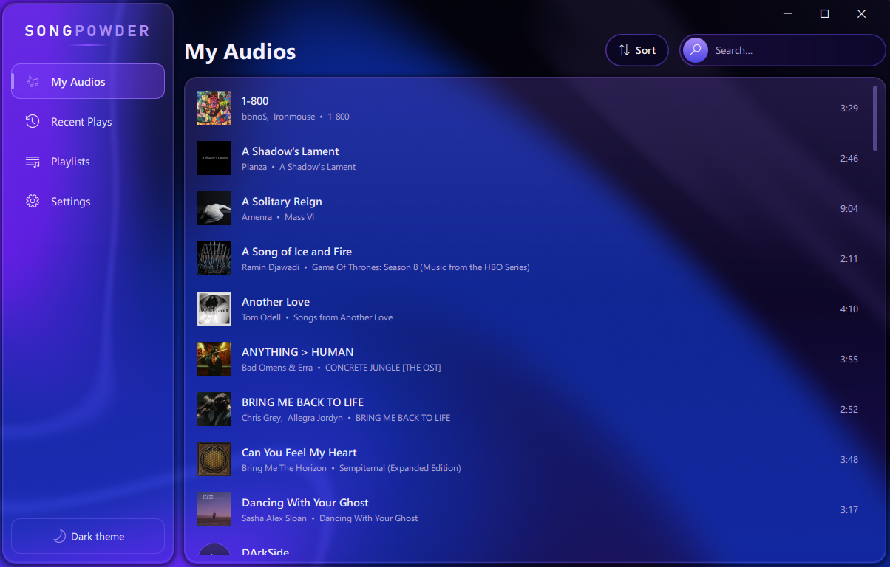
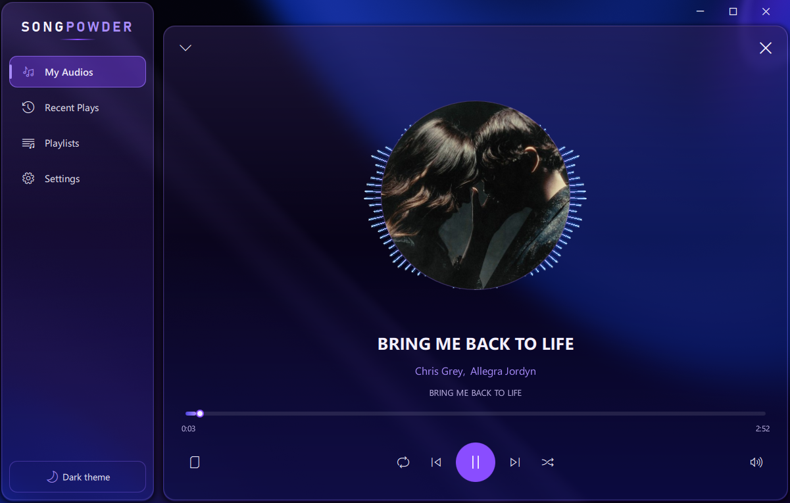
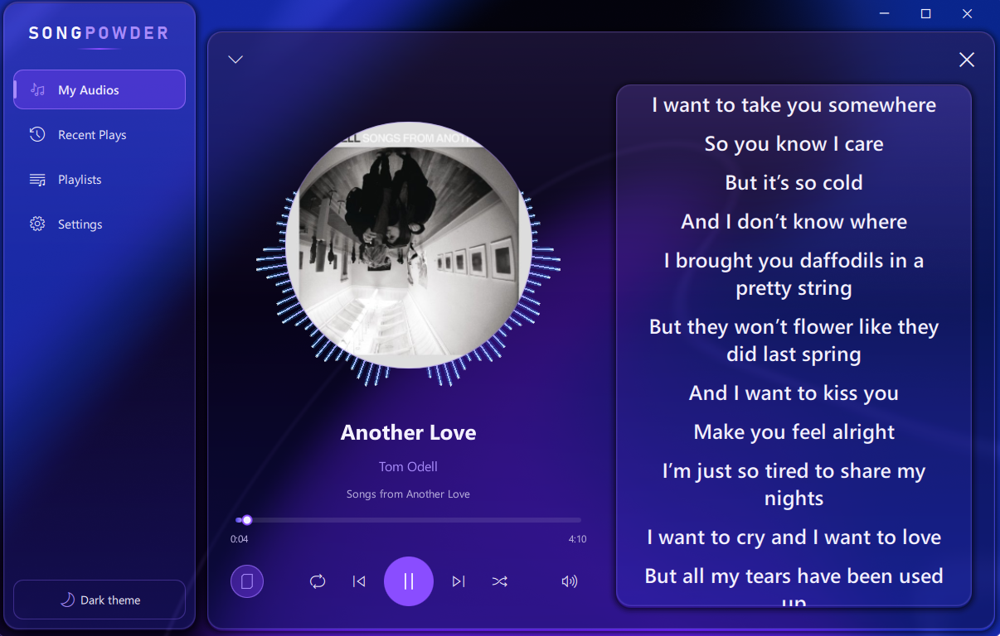
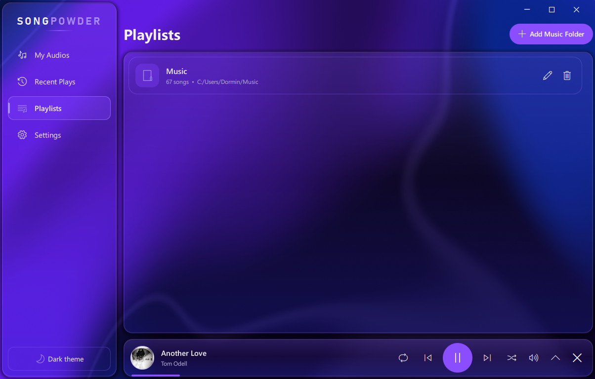
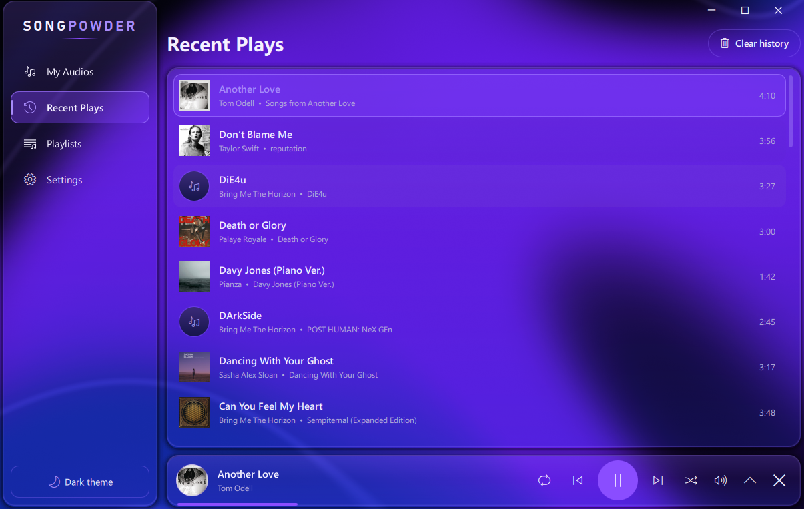
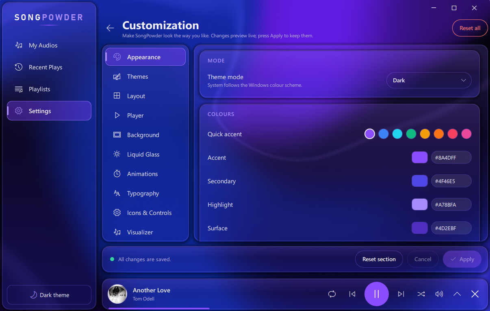

<div align="right" dir="rtl">

[🇮🇷 فارسی](README.fa.md)

</div>

<div align="center">


# SongPowder

**A fast, modern music player for Windows with a Liquid Glass look.**

Built with C++20, Qt 6 and QML.


</div>

---

SongPowder plays the music you already have. Point it at your folders and it does the rest: it scans them in the background, reads tags and cover art, keeps an eye on changes, and never moves, copies or deletes your files. Light and dark themes, synced lyrics, a live equalizer ring around the cover, and a deep customization page make it feel like yours.

## Features

- **Folders as playlists.** Add as many music folders as you like. Each one becomes a playlist and is watched for changes.
- **Background scanning.** Tags and artwork are read without freezing the interface. Files that cannot be decoded are detected and hidden.
- **Real playback.** Play, pause, seek, next, previous, loop, and shuffle that never repeats a song until the whole cycle is done.
- **Synced lyrics.** Reads `.lrc`,txt (including word-by-word), SRT and WebVTT files, and plain text. Persian and Arabic text is fully supported, including right-to-left layouts.
- **Live equalizer.** A radial spectrum around the album cover that follows the music in real time.
- **Customization.** Colors, fonts, glass effect, motion, layout and player style, with themes and profiles you can save, import and export.
- **Recent plays.** Your listening history is stored locally in SQLite.
- **Wide format support.** MP3, FLAC, WAV, AAC, M4A, OGG, OPUS, WMA and AIFF (the exact list depends on the Qt FFmpeg backend).

## App Screenshots

<table>
  <tr>
    <td align="center"><br /><sub>My Audios</sub></td>
    <td align="center"><br /><sub>Now Playing</sub></td>
  </tr>
  <tr>
    <td align="center"><br /><sub>Synced Lyrics</sub></td>
    <td align="center"><br /><sub>Playlists</sub></td>
  </tr>
  <tr>
    <td align="center"><br /><sub>Recent Plays</sub></td>
    <td align="center"><br /><sub>Customization</sub></td>
  </tr>
</table>

## Using the Source Code

There are three ways to work with the project. All commands assume you are in the project's root folder.

### 1. Build the portable app and the installer in one step

Open PowerShell and run:

```powershell
.\scripts\package.bat -QtDir "C:\Qt installation path\Folder Version\msvc2022_64" -InnoDir "Inno Setup6 installation path"
```

If you leave out `-QtDir`, the script tries to find your Qt installation on its own. When it finishes, you will find the results in the `dist` folder:

```text
dist\SongPowder\                      portable folder, run SongPowder.exe
dist\SongPowder-Portable-<version>.zip
dist\SongPowder-Setup-<version>.exe   installer
```

Useful options: `-RunTests`, `-SmokeTest`, `-SkipInstaller`, `-SkipPortableZip` and `-Clean`.

### 2. Open it in Qt Creator

1. Open `CMakeLists.txt` in Qt Creator.
2. Choose the **Desktop Qt 6.x MSVC2022 64-bit** kit.
3. Press **Run**.

### 3. Build from the command line

Use the *x64 Native Tools Command Prompt for Visual Studio*:

```bat
cmake -S . -B build\release -G Ninja -DCMAKE_BUILD_TYPE=Release -DCMAKE_PREFIX_PATH=C:/Qt/6.8.1/msvc2022_64
cmake --build build\release
ctest --test-dir build\release --output-on-failure
```

More details are in [docs/BUILD.md](docs/BUILD.md), and the design decisions are explained in [docs/ARCHITECTURE.md](docs/ARCHITECTURE.md).

## Prerequisites

| Requirement | Version |
|---|---|
| Windows | 10 or 11 (64-bit) |
| Visual Studio | 2022 or newer, with the **Desktop development with C++** workload |
| Qt | 6.5 or newer (the MSVC 64-bit kit), tested with 6.8 and 6.12 |
| CMake | 3.21 or newer |
| Ninja | Any recent version (also bundled with Visual Studio and Qt) |
| Inno Setup | 6.x, only needed to create the installer |

When installing Qt, make sure these modules are selected: **Qt Multimedia**, **Qt Quick Controls**, **Qt Quick Dialogs**, **Qt Shader Tools** and **Qt SQL**.

Your library, settings and cover cache are stored in `%LOCALAPPDATA%\SongPowder`, so nothing is written next to the executable.

## Recommended Channel

By visiting the [PC Gaming Hub](https://t.me/pcgaminghub) Telegram channel, you can follow the latest gaming and technology news.

## Donation

If you would like to support me, you can send a donation to the following address:

`TMKpNvJ73RR6g2NQ3b18eAHZuXCkbiTUv7`

IRL -> https://reymit.ir/drwander84

## License

SongPowder is released under the [Apache License 2.0](LICENSE).

If you use, copy or modify this source code, you must keep the [LICENSE](LICENSE) and [NOTICE](NOTICE) files, credit the original author, say clearly that the code comes from SongPowder, and mark the files you changed.

Qt is used under the LGPLv3 and linked dynamically. The Qt FFmpeg backend bundles FFmpeg under the LGPL.

Created by [DRwander](https://github.com/DRwander84).